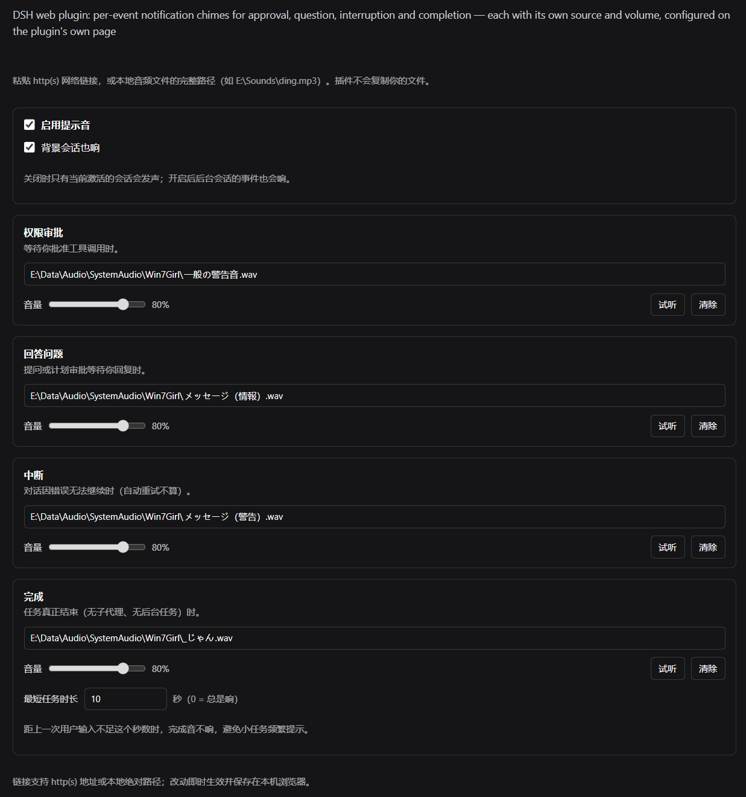

# dsh-chime

[English](README.en.md) | 中文

DSH（DeepSeek Harness）Web 通知音效插件。

## 四类事件

| 音效 | 触发时机 |
|---|---|
| **权限审批** | 工具调用等待批准时（`pendingInteraction === 'approval'`） |
| **回答问题** | `ask_user_question` 提问或计划审批时（`question` / `plan-review`） |
| **中断** | 对话因错误无法继续时（**最终**错误，自动重试不会响） |
| **完成** | 任务**真正**结束时（无运行中的 agent、无在跑子代理、无后台任务） |

## 特性

- **链接式音源** —— 插件**不复制**你的音频文件：
  - 粘贴 `http(s)` 网络链接，或
  - 粘贴本地音频文件的**完整路径**（Linux/macOS 如 `/home/you/ding.mp3`，Windows 如 `E:\Sounds\ding.mp3`），由插件的 host half 暴露成**同源 URL** 播放。
- **每个音效独立音量**：0–100 独立调节，互不影响。
- **提醒时机可选**：同时看「事情发生在哪个会话」和「你此刻在不在 DSH」两个维度，共五档 —— 只看当前会话 / 只在我不在时 / 我不在或事情在别的会话（推荐）/ 总是 / 从不。音效与通知各自选档，但共用同一套判定。
- **后台也响**：窗口切到后台、或者一挂二十分钟，事件一到就响，不用等你切回来。
- **系统通知（独立开关）**：事件发生时弹一条桌面通知，Windows / macOS / Linux 都走系统通知中心。它与音效是两条独立通道，提醒时机单独设置；**点一下通知直接回到对应对话**。另有实验性开关：点击通知时把桌面窗口带到前台（默认关闭，仅 Desktop 安装有效）。
- **不误报**：后台 bash 任务、后台子代理仍在运行时不会误报「完成」；会被自动重试的失败不会触发「中断」。
- **默认静音**：没配置的音效不会响，也不会退回到内置提示音。

## 配置位置

**插件 → 本插件页面**（或插件页的**提示音**卡片）。表单直接渲染在插件页上，不用点进组件行。

所有修改即时生效，没有单独的保存按钮。



## 可选经验球组件

组件列表新增默认关闭的 **经验球**（`chime-xp`）。开启组件后，进入该行的配置页，设置自备音源并启用自动经验音。任意工具调用完成后，按可配置的随机时长和频率连续播放 MC 风格变调音。原通知组件可独立开关，设置互不影响。

默认 1–3 秒、每秒 6 声、10% 音量，失焦暂停。支持单声与 10 秒节奏试听；不附带或下载 MC 音效。详见[经验球规则与设置](docs/xp-orbs.md)。

## 安装

> 安装会改动 `%USERPROFILE%\.dsh` 下的 profile 配置，请确认后执行。支持 HMR 的 profile 通常会热重组；不要自动重启 DSH 或打断正在运行的会话。

仓库：<https://github.com/AkotaP/dsh-chime>

**在「插件」页里装**：侧边栏「插件」→「添加插件」，填入仓库地址 `https://github.com/AkotaP/dsh-chime`（同处也接受 npm 包名 `dsh-chime`、本地目录绝对路径和 tarball）。DSH 会先用 `git ls-remote` 探一次仓库再交给 pnpm，装完在列表里确认它是启用状态。

**一条命令**（等价写法）：

```powershell
dsh plugin --profile desktop add https://github.com/AkotaP/dsh-chime
# 发布到 npm 之后可以直接用包名：dsh plugin --profile desktop add dsh-chime
```

**让 agent 装**（把下面这段发给 DSH 里的 agent）：

> 把这个仓库装进当前 DSH 的 desktop profile：`https://github.com/AkotaP/dsh-chime`。用侧边栏「插件」页的「添加插件」，或 `dsh plugin --profile desktop add https://github.com/AkotaP/dsh-chime`。装完确认 profile 的 `dsh.profile.bundles` 里已经有 `dsh-chime`，然后确认插件页的**提示音**卡片能打开配置表单；仅在宿主明确报告需要重启时另行询问，不自动重启。

**本地开发**（以 link 方式装进某个 profile，源码改动实时生效）：见下面的[开发](#开发)一节。

装好后在插件页确认应用状态及配置表单；仅在宿主明确报告需要重启时另行确认。卸载：侧边栏「插件」页里卸载，或 `dsh plugin --profile desktop remove dsh-chime`（并确认 `dsh.profile.bundles` 里已移除该项）。

## 实现要点

- **纯 Client 为主**：配置与播放引擎都在浏览器侧，持久化在 `localStorage`（key `dsh.chime.config.v1`），**不写 DSH profile**。
- **极薄的 host half**：只注册两条 loopback HTTP 路由，没有任何 Host Remote 依赖。
  - `GET /dsh-chime/asset?path=<绝对路径>` —— 音频字节，正确的 `Content-Type`，支持 `Range`/`206`，`Cache-Control: no-store`
  - `GET /dsh-chime/list?path=<目录>` —— 目录条目（当前入口已屏蔽，暂未使用）
- **为什么走 host 路由读本地文件**：DSH 的 Client Remote 面**没有 mount `workspaceFiles`**，原生目录选择器又只支持选目录、不支持列目录。把本地文件通过 DSH 自己的 HTTP 服务暴露成**同源 URL**，浏览器就会当普通资源处理 —— 不落盘、不复制，也不受 Remote 通道限制。
- **播放走 Web Audio**（`AudioContext` + `decodeAudioData` + `BufferSource` + `GainNode`）。
  插件会在首次 `pointerdown`/`keydown` 解锁 `AudioContext`，之后自动播放才被允许。
- **事件驱动为主、轮询兜底**：订阅 DSH 的 `uiSession.sessionStatus` 与 `sessions.list`，状态一变立即判定，窗口回到前台时再补一次；400ms 轮询只当保险丝。后台页面会被节流 —— 隐藏标签页的 `setTimeout` 被拉长到秒级甚至更粗（浏览器里开着「内存节省」还可能直接冻结标签页），纯轮询会让「提问 / 审批」音效压到你切回 DSH 才响。订阅走 DSH 的 remote 推送，不经过定时器，所以窗口藏在后台照样即时。
- **通知是第二条独立通道**：只认 `config.notify`（总开关 + 逐类开关），走浏览器的 `Notification`，每条固定 `silent: true`（声音归音效管，否则会「双响」）。首次要在设置页点一次「授权」—— 浏览器要求权限请求落在用户手势里；环境不支持或权限被拒时静默降级，不报错。点击通知会走 ui-workspace 的 `openSession` 切回该事件所属的对话，并在会话已不存在或宿主没有该能力时退回只聚焦窗口，绝不报错。桌面版还有实验性的「把窗口带到前台」开关（`notify.raiseWindow`，默认关闭）：Windows 按 Desktop 进程定位窗口，恢复最小化，关闭到托盘时通过桌面外壳显示，再核对实际前台状态；普通后台仍无法激活时，只做一次短暂最小化/恢复，可能出现闪动。macOS / Linux 走 `dsh://open`。并发点击共享一个短命辅助进程；系统仍可能拒绝激活，失败会保留诊断，不保证每次成功。网页里没有窗口控制权限，所以 Web 安装直接跳过。
- **事件判定**参考 DSH 自身的侧边栏状态机：`running` 只表示 agent loop 在跑，**不等于**任务结束，所以「完成」用复合判定（见 [`CONTRACT.md`](./CONTRACT.md) §3）。

## 开发

```bash
pnpm install
node build.mjs                 # 产出通知与经验球两组 host/client bundle
node test/detect.test.mjs      # 43 个事件判定用例
node tools/verify-apply.mjs    # 用 stub context 真正执行一次 apply()
node tools/verify-host-routes.mjs
```

```bash
# 以 link 方式装进某个 profile 做真机调试（会先备份 package.json）
node tools/link-install.mjs web
```

> 构建说明：本仓库的 `build.mjs` 直接调用平台 esbuild 二进制（`stdio: 'inherit'`），
> 不使用 esbuild 的 JS API —— 后者会以管道方式 spawn 子进程，在 DSH 文件沙箱下会被拒绝（EPERM）。

架构、用到的 DSH API 面、事件规则见 [`CONTRACT.md`](./CONTRACT.md)；版本历史见 [`CHANGELOG.md`](./CHANGELOG.md)。

## 兼容性

- Node.js `>=20`
- DSH `>=0.2.1-rc.2`

## 许可

[MIT](./LICENSE)
